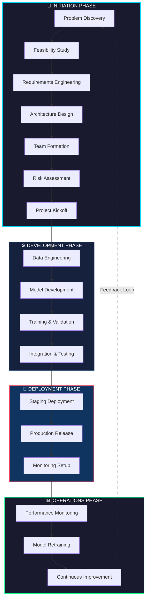
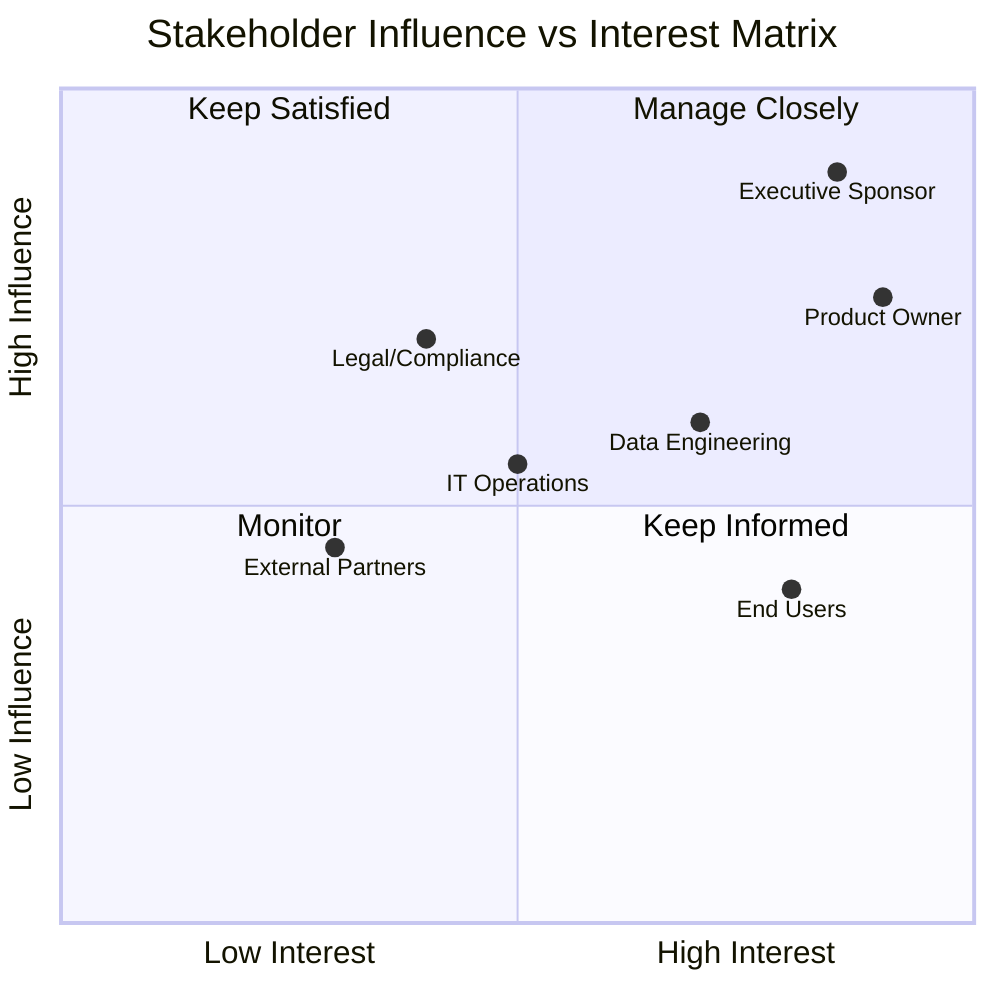
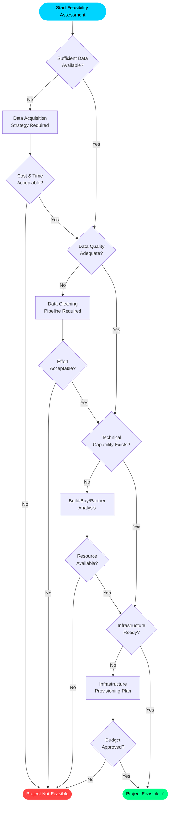
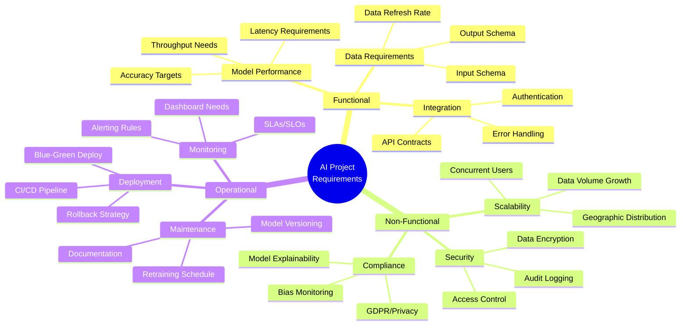
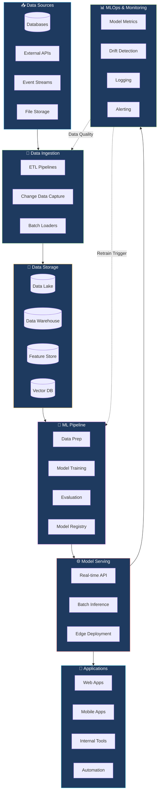
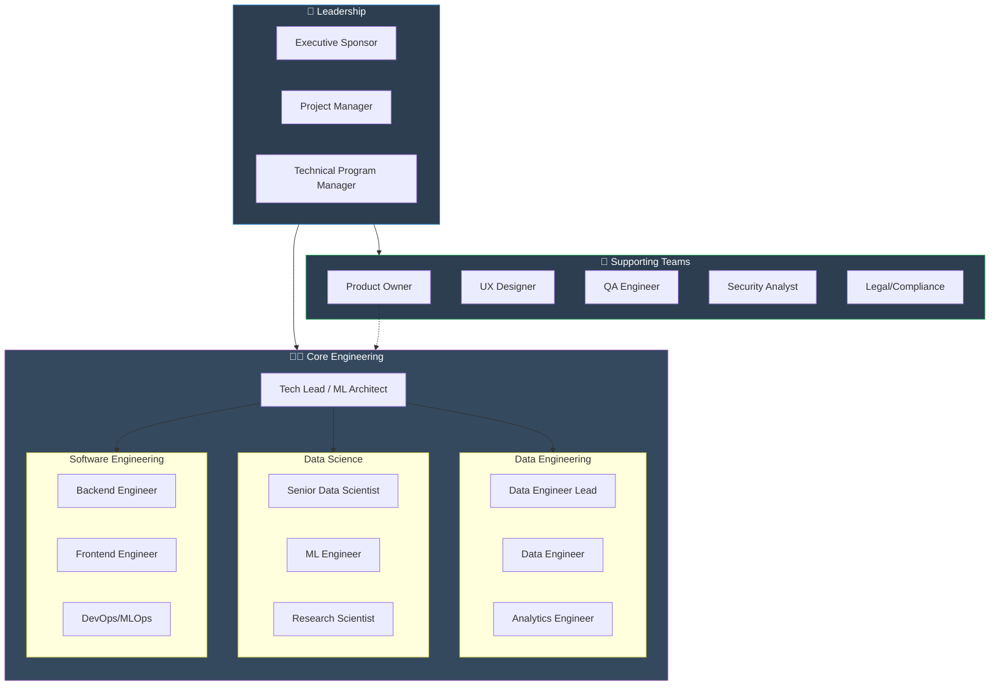
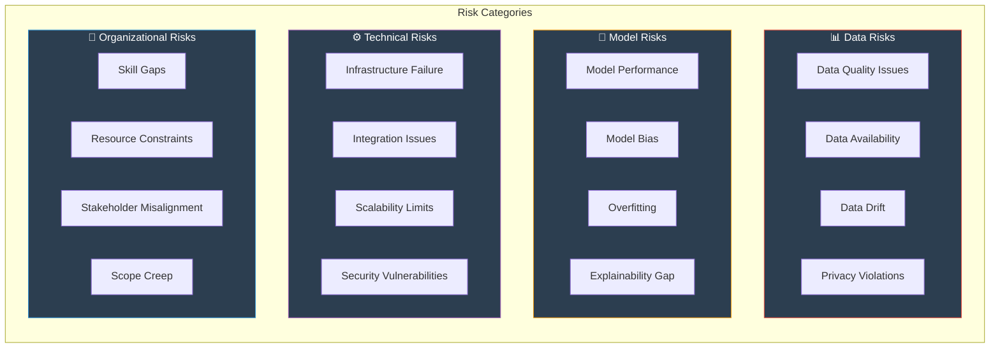
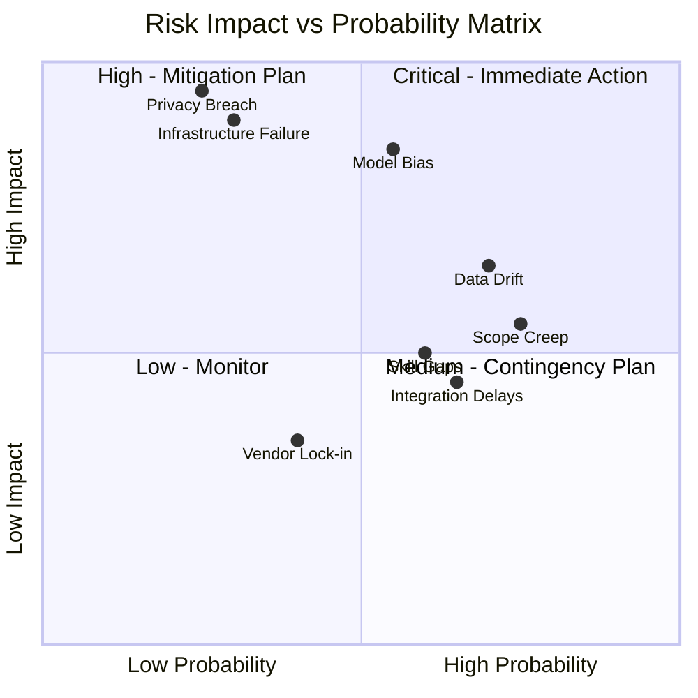
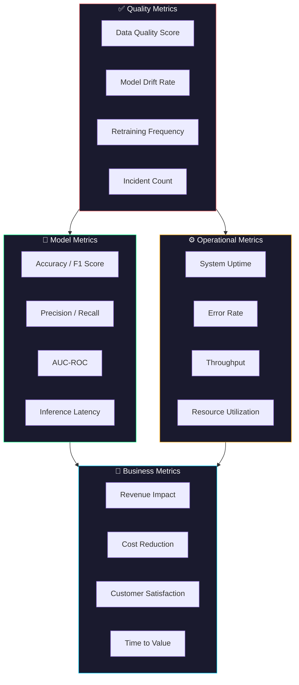

# 🚀 AI Project Initiation Guide

## A Professional Framework for Starting AI/ML Projects the Right Way

---

> [!IMPORTANT]
> This guide establishes the foundational practices for initiating AI/ML projects. Following this structured approach ensures project success, stakeholder alignment, and technical excellence from day one.

---

## Table of Contents

1. [Executive Overview](#1-executive-overview)
2. [Project Lifecycle Framework](#2-project-lifecycle-framework)
3. [Phase 1: Discovery & Problem Definition](#3-phase-1-discovery--problem-definition)
4. [Phase 2: Feasibility Assessment](#4-phase-2-feasibility-assessment)
5. [Phase 3: Requirements Engineering](#5-phase-3-requirements-engineering)
6. [Phase 4: Architecture & Design](#6-phase-4-architecture--design)
7. [Phase 5: Team Structure & Governance](#7-phase-5-team-structure--governance)
8. [Phase 6: Risk Management](#8-phase-6-risk-management)
9. [Phase 7: Success Metrics & KPIs](#9-phase-7-success-metrics--kpis)
10. [Project Kickoff Checklist](#10-project-kickoff-checklist)
11. [Templates & Artifacts](#11-templates--artifacts)

---

## 1. Executive Overview

### Purpose

This guide provides AI Engineers with a systematic, professional-grade framework for initiating AI/ML projects. It ensures:

- **Alignment** between business objectives and technical capabilities
- **Clarity** in project scope, deliverables, and success criteria
- **Governance** through proper documentation and approval gates
- **Risk Mitigation** through early identification and planning
- **Excellence** in technical architecture and implementation standards

### When to Use This Guide

| Scenario                                     | Applicability                         |
| -------------------------------------------- | ------------------------------------- |
| New AI/ML product development                | ✅ Full guide                         |
| Research & experimentation projects          | ✅ Phases 1-4                         |
| AI feature integration into existing systems | ✅ Phases 3-7                         |
| Model retraining or optimization             | ⚡ Abbreviated (Phases 4, 6, 7)       |
| Proof of Concept (PoC)                       | ✅ Phases 1-4 with lighter governance |

---

## 2. Project Lifecycle Framework

### AI/ML Project Phases Overview



### Gate Reviews

Each phase concludes with a formal gate review:

| Gate   | Phase Exit              | Key Approvals Required              |
| ------ | ----------------------- | ----------------------------------- |
| **G0** | Discovery Complete      | Business Sponsor, Product Owner     |
| **G1** | Feasibility Approved    | Technical Lead, Data Science Lead   |
| **G2** | Requirements Signed Off | All Stakeholders                    |
| **G3** | Architecture Approved   | Enterprise Architect, Security Team |
| **G4** | Project Kickoff         | Steering Committee                  |

---

## 3. Phase 1: Discovery & Problem Definition

### 3.1 Business Context Analysis

#### Stakeholder Identification Matrix



### 3.2 Problem Statement Framework

Use the **SMART-AI** framework to define your problem:

| Dimension          | Question                             | Example                                                                             |
| ------------------ | ------------------------------------ | ----------------------------------------------------------------------------------- |
| **S**pecific       | What exact problem are we solving?   | "Reduce customer churn by predicting at-risk customers 30 days before cancellation" |
| **M**easurable     | How will we measure success?         | "Achieve 85% precision in churn prediction with <5% false positive rate"            |
| **A**chievable     | Is this technically feasible?        | "Historical data exists, similar models have been deployed successfully"            |
| **R**elevant       | Does this align with business goals? | "Directly supports Q3 retention initiative"                                         |
| **T**ime-bound     | What is the delivery timeline?       | "MVP in 8 weeks, production in 12 weeks"                                            |
| **A**I-Appropriate | Is ML the right approach?            | "Pattern complexity exceeds rule-based solutions"                                   |
| **I**mpactful      | What is the expected ROI?            | "Projected $2M annual savings from reduced churn"                                   |

### 3.3 Discovery Artifacts Checklist

- [ ] Problem Statement Document
- [ ] Business Case with ROI Analysis
- [ ] Stakeholder Register
- [ ] Initial Data Availability Assessment
- [ ] Competitive/Industry Analysis
- [ ] Regulatory Considerations Document

---

## 4. Phase 2: Feasibility Assessment

### 4.1 Technical Feasibility Decision Tree



### 4.2 Data Readiness Assessment

#### Data Inventory Template

| Data Source  | Type            | Volume      | Quality Score | Accessibility | Owner    | Gap Analysis                |
| ------------ | --------------- | ----------- | ------------- | ------------- | -------- | --------------------------- |
| Customer DB  | Structured      | 10M records | 8/10          | API Available | Data Eng | Missing: 6 mo. history      |
| User Events  | Semi-structured | 500GB/day   | 7/10          | Kafka Stream  | Platform | Need schema standardization |
| External API | Structured      | On-demand   | 6/10          | Rate Limited  | Vendor   | Cost: $5K/month             |

### 4.3 Technology Stack Evaluation

```mermaid
flowchart LR
    subgraph COMPUTE["💻 Compute Layer"]
        direction TB
        C1[Cloud VMs]
        C2[Kubernetes]
        C3[Serverless]
    end

    subgraph ML_PLATFORM["🤖 ML Platform"]
        direction TB
        M1[MLflow]
        M2[Kubeflow]
        M3[SageMaker]
        M4[Vertex AI]
    end

    subgraph DATA_LAYER["📊 Data Layer"]
        direction TB
        D1[Data Lake]
        D2[Feature Store]
        D3[Vector DB]
    end

    subgraph SERVING["🌐 Serving Layer"]
        direction TB
        S1[REST API]
        S2[gRPC]
        S3[Batch Inference]
        S4[Real-time Stream]
    end

    subgraph MONITORING["📈 Observability"]
        direction TB
        O1[Model Metrics]
        O2[Data Drift]
        O3[Alerting]
    end

    DATA_LAYER --> ML_PLATFORM
    ML_PLATFORM --> COMPUTE
    COMPUTE --> SERVING
    SERVING --> MONITORING
    MONITORING -.->|Feedback| DATA_LAYER

    style COMPUTE fill:#2d3436,stroke:#00cec9,color:#fff
    style ML_PLATFORM fill:#2d3436,stroke:#6c5ce7,color:#fff
    style DATA_LAYER fill:#2d3436,stroke:#fdcb6e,color:#fff
    style SERVING fill:#2d3436,stroke:#e17055,color:#fff
    style MONITORING fill:#2d3436,stroke:#00b894,color:#fff
```



---

## 5. Phase 3: Requirements Engineering

### 5.1 Requirements Categories



### 5.2 Functional Requirements Template

| ID     | Requirement                                    | Priority | Acceptance Criteria                      | Dependencies           |
| ------ | ---------------------------------------------- | -------- | ---------------------------------------- | ---------------------- |
| FR-001 | Model shall predict customer churn probability | P0       | Prediction accuracy ≥ 85% on holdout set | Data pipeline: DP-001  |
| FR-002 | API response time shall be < 200ms at P99      | P0       | Load test validated at 1000 RPS          | Infrastructure: IN-002 |
| FR-003 | System shall provide prediction explanations   | P1       | SHAP values for top 5 features           | Model: ML-001          |
| FR-004 | Batch predictions for 1M customers daily       | P1       | Complete within 4-hour window            | Compute: CM-003        |

### 5.3 Non-Functional Requirements Checklist

#### Performance Requirements

- [ ] Maximum latency for real-time inference
- [ ] Throughput requirements (requests/second)
- [ ] Batch processing window constraints

#### Scalability Requirements

- [ ] Expected user/request growth rate
- [ ] Horizontal scaling strategy
- [ ] Auto-scaling policies defined

#### Security Requirements

- [ ] Data encryption requirements (at rest, in transit)
- [ ] Authentication/Authorization mechanisms
- [ ] Audit logging requirements
- [ ] Penetration testing requirements

#### Compliance Requirements

- [ ] Data privacy regulations (GDPR, CCPA, etc.)
- [ ] Model explainability requirements
- [ ] Bias and fairness testing requirements
- [ ] Data retention policies

---

## 6. Phase 4: Architecture & Design

### 6.1 Reference AI/ML Architecture



### 6.2 Architecture Decision Records (ADR)

> [!NOTE]
> Document all significant architectural decisions using ADRs to maintain institutional knowledge and provide context for future team members.

#### ADR Template

```markdown
# ADR-001: [Decision Title]

## Status

[Proposed | Accepted | Deprecated | Superseded]

## Context

[Describe the issue that motivated this decision]

## Decision

[Describe the decision that was made]

## Consequences

### Positive

- [Benefit 1]
- [Benefit 2]

### Negative

- [Tradeoff 1]
- [Tradeoff 2]

### Risks

- [Risk 1 and mitigation]

## Alternatives Considered

| Option | Pros | Cons | Why Rejected |
| ------ | ---- | ---- | ------------ |
| Alt 1  | ...  | ...  | ...          |
| Alt 2  | ...  | ...  | ...          |
```

### 6.3 Infrastructure Sizing Guidelines

| Component             | Small (PoC)     | Medium (Production) | Large (Enterprise)            |
| --------------------- | --------------- | ------------------- | ----------------------------- |
| **Training Compute**  | 1x GPU (T4)     | 4x GPU (A100)       | 8+ GPU Cluster                |
| **Inference Servers** | 2 CPU instances | 4-8 GPU instances   | Auto-scaling cluster          |
| **Feature Store**     | 100GB SSD       | 1TB NVMe            | Distributed (Redis Cluster)   |
| **Model Registry**    | Local S3        | Managed MLflow      | Enterprise (Weights & Biases) |
| **Data Lake**         | 1TB             | 50TB                | 500TB+                        |
| **Vector DB**         | 1M vectors      | 100M vectors        | 1B+ vectors                   |

---

## 7. Phase 5: Team Structure & Governance

### 7.1 AI Project Team Structure



### 7.2 RACI Matrix

| Activity                  | Executive Sponsor | Tech Lead | Data Scientist | Data Engineer | PM    |
| ------------------------- | ----------------- | --------- | -------------- | ------------- | ----- |
| Project Approval          | **A**             | C         | I              | I             | **R** |
| Architecture Design       | I                 | **A/R**   | C              | C             | I     |
| Data Pipeline Development | I                 | C         | C              | **A/R**       | I     |
| Model Development         | I                 | C         | **A/R**        | C             | I     |
| Production Deployment     | I                 | **A**     | C              | C             | **R** |
| Performance Monitoring    | I                 | C         | **R**          | C             | **A** |

**Legend:** R = Responsible, A = Accountable, C = Consulted, I = Informed

### 7.3 Governance Framework

#### Meeting Cadence

| Meeting            | Frequency | Duration | Attendees                 | Purpose                          |
| ------------------ | --------- | -------- | ------------------------- | -------------------------------- |
| Daily Standup      | Daily     | 15 min   | Core Team                 | Progress sync, blockers          |
| Sprint Planning    | Bi-weekly | 2 hours  | Core + Product            | Sprint goals, task allocation    |
| Technical Review   | Weekly    | 1 hour   | Engineers                 | Architecture, code review        |
| Stakeholder Update | Bi-weekly | 30 min   | Leadership + Stakeholders | Progress, risks, decisions       |
| Steering Committee | Monthly   | 1 hour   | Executives                | Strategic decisions, escalations |

---

## 8. Phase 6: Risk Management

### 8.1 AI/ML Project Risk Categories



### 8.2 Risk Assessment Matrix



### 8.3 Risk Register Template

| Risk ID | Description                                   | Category       | Probability | Impact   | Risk Score | Mitigation Strategy                                          | Owner     | Status     |
| ------- | --------------------------------------------- | -------------- | ----------- | -------- | ---------- | ------------------------------------------------------------ | --------- | ---------- |
| R-001   | Training data quality degrades model accuracy | Data           | High        | Critical | 🔴         | Implement data validation pipeline, automated quality checks | Data Lead | Open       |
| R-002   | Model exhibits bias against protected groups  | Model          | Medium      | Critical | 🟠         | Fairness testing in CI/CD, regular bias audits               | DS Lead   | Open       |
| R-003   | Integration with legacy system causes delays  | Technical      | Medium      | High     | 🟠         | Early integration testing, dedicated integration sprint      | Tech Lead | Mitigating |
| R-004   | Key ML engineer leaves project                | Organizational | Low         | High     | 🟡         | Cross-training, documentation, knowledge sharing sessions    | PM        | Monitoring |

---

## 9. Phase 7: Success Metrics & KPIs

### 9.1 Metrics Framework



### 9.2 KPI Dashboard Template

| Metric Category | KPI                             | Target      | Current | Trend | Health |
| --------------- | ------------------------------- | ----------- | ------- | ----- | ------ |
| **Business**    | Revenue from ML recommendations | $1M/quarter | $850K   | ↗️    | 🟡     |
| **Business**    | Churn reduction rate            | 20%         | 18%     | ↗️    | 🟡     |
| **Model**       | Prediction accuracy             | ≥ 90%       | 92%     | →     | 🟢     |
| **Model**       | Inference latency (P99)         | < 100ms     | 85ms    | →     | 🟢     |
| **Operational** | System uptime                   | 99.9%       | 99.95%  | →     | 🟢     |
| **Operational** | Error rate                      | < 0.1%      | 0.08%   | ↘️    | 🟢     |
| **Quality**     | Data freshness                  | < 1 hour    | 45 min  | →     | 🟢     |
| **Quality**     | Model drift score               | < 0.05      | 0.03    | →     | 🟢     |

### 9.3 Success Criteria Definition

> [!TIP]
> Define success criteria at three levels: Minimum Viable, Target, and Stretch goals to provide flexibility in measuring project success.

| Dimension          | Minimum Viable | Target   | Stretch   |
| ------------------ | -------------- | -------- | --------- |
| Model Accuracy     | 80%            | 90%      | 95%       |
| Latency (P99)      | 500ms          | 100ms    | 50ms      |
| Throughput         | 100 RPS        | 1000 RPS | 10000 RPS |
| Time to Production | 16 weeks       | 12 weeks | 8 weeks   |
| ROI (Year 1)       | 1.5x           | 3x       | 5x        |

---

## 10. Project Kickoff Checklist

### Pre-Kickoff Verification

```
┌─────────────────────────────────────────────────────────────────┐
│                    PROJECT KICKOFF READINESS                     │
├─────────────────────────────────────────────────────────────────┤
│                                                                  │
│  ☐ Problem Statement Approved                                   │
│  ☐ Business Case with ROI Approved                              │
│  ☐ Feasibility Assessment Completed                             │
│  ☐ Requirements Document Signed Off                             │
│  ☐ Architecture Design Approved                                 │
│  ☐ Team Assembled and Onboarded                                 │
│  ☐ Risk Register Created                                        │
│  ☐ Success Metrics Defined                                      │
│  ☐ Infrastructure Provisioned                                   │
│  ☐ Development Environment Ready                                │
│  ☐ CI/CD Pipeline Configured                                    │
│  ☐ Data Access Granted                                          │
│  ☐ Security Review Completed                                    │
│  ☐ Compliance Sign-off Obtained                                 │
│  ☐ Communication Plan Established                               │
│  ☐ Kickoff Meeting Scheduled                                    │
│                                                                  │
└─────────────────────────────────────────────────────────────────┘
```

### Kickoff Meeting Agenda

| Time  | Topic                           | Owner             | Duration |
| ----- | ------------------------------- | ----------------- | -------- |
| 00:00 | Welcome & Introductions         | PM                | 10 min   |
| 00:10 | Project Vision & Objectives     | Executive Sponsor | 15 min   |
| 00:25 | Problem Statement & Scope       | Product Owner     | 15 min   |
| 00:40 | Technical Architecture Overview | Tech Lead         | 20 min   |
| 01:00 | Team Structure & Roles          | PM                | 10 min   |
| 01:10 | Timeline & Milestones           | PM                | 15 min   |
| 01:25 | Risk Overview                   | Tech Lead         | 10 min   |
| 01:35 | Success Metrics & KPIs          | Data Science Lead | 10 min   |
| 01:45 | Q&A                             | All               | 15 min   |
| 02:00 | Next Steps & Action Items       | PM                | 10 min   |

---

## 11. Templates & Artifacts

### Required Documents Checklist

| Document               | Owner         | Review By                         | Due Date | Status |
| ---------------------- | ------------- | --------------------------------- | -------- | ------ |
| Project Charter        | PM            | Steering Committee                | Week 1   | ☐      |
| Business Case          | Product Owner | Finance, Executives               | Week 1   | ☐      |
| Technical Requirements | Tech Lead     | Architecture Review Board         | Week 2   | ☐      |
| Data Requirements      | Data Lead     | Data Governance                   | Week 2   | ☐      |
| Architecture Design    | Tech Lead     | Security, Enterprise Architecture | Week 3   | ☐      |
| Risk Register          | PM            | All Stakeholders                  | Week 3   | ☐      |
| Project Plan           | PM            | Project Sponsor                   | Week 3   | ☐      |
| Resource Plan          | PM            | HR, Finance                       | Week 2   | ☐      |
| Communication Plan     | PM            | All Stakeholders                  | Week 1   | ☐      |

### Project Charter Template

```
╔══════════════════════════════════════════════════════════════════╗
║                      PROJECT CHARTER                              ║
╠══════════════════════════════════════════════════════════════════╣
║                                                                   ║
║  Project Name: _______________________________________________   ║
║  Project Code: _______________________________________________   ║
║  Start Date:   _______________________________________________   ║
║  End Date:     _______________________________________________   ║
║                                                                   ║
║  ─────────────────────────────────────────────────────────────   ║
║  EXECUTIVE SUMMARY                                               ║
║  [1-2 paragraphs describing the project]                         ║
║  ─────────────────────────────────────────────────────────────   ║
║                                                                   ║
║  OBJECTIVES                                                       ║
║  1. ___________________________________________________________  ║
║  2. ___________________________________________________________  ║
║  3. ___________________________________________________________  ║
║                                                                   ║
║  ─────────────────────────────────────────────────────────────   ║
║  SCOPE                                                           ║
║  In Scope:                                                       ║
║  • ___________________________________________________________   ║
║  • ___________________________________________________________   ║
║                                                                   ║
║  Out of Scope:                                                   ║
║  • ___________________________________________________________   ║
║  • ___________________________________________________________   ║
║                                                                   ║
║  ─────────────────────────────────────────────────────────────   ║
║  KEY STAKEHOLDERS                                                ║
║  Executive Sponsor: ___________________________________________  ║
║  Project Manager:   ___________________________________________  ║
║  Technical Lead:    ___________________________________________  ║
║                                                                   ║
║  ─────────────────────────────────────────────────────────────   ║
║  APPROVALS                                                       ║
║  Name: _________________ Signature: __________ Date: _________   ║
║  Name: _________________ Signature: __________ Date: _________   ║
║                                                                   ║
╚══════════════════════════════════════════════════════════════════╝
```

---

## Quick Reference Card

> [!CAUTION]
> Skipping initiation phases leads to project failure. Studies show that projects with proper initiation are **2.5x more likely to succeed**.

### The 7 Pillars of AI Project Initiation

```
 ┌───────────────────────────────────────────────────────────────┐
 │                                                                │
 │    1️⃣  DISCOVER    →  Define the problem worth solving         │
 │                                                                │
 │    2️⃣  ASSESS      →  Validate technical feasibility          │
 │                                                                │
 │    3️⃣  REQUIRE     →  Capture all needs precisely             │
 │                                                                │
 │    4️⃣  ARCHITECT   →  Design for scale and maintainability    │
 │                                                                │
 │    5️⃣  ORGANIZE    →  Build the right team structure          │
 │                                                                │
 │    6️⃣  MITIGATE    →  Identify and plan for risks             │
 │                                                                │
 │    7️⃣  MEASURE     →  Define what success looks like          │
 │                                                                │
 └───────────────────────────────────────────────────────────────┘
```

---

**Document Version:** 2.5  
**Last Updated:** October 2025  
**Author:** AI Engineering Team
**Review Cycle:** Quarterly

---

> _"The beginning is the most important part of the work."_ — Plato
